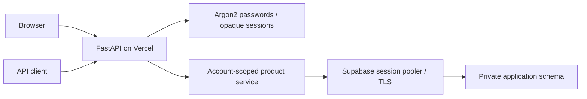

# QQ Kashmir: architecture and tradeoffs

## Separation of concerns

`accounts.py` owns identity, session digests, key revocation, origin checks and rate limiting. `product.py` owns domain transactions and route authorization. `app.py` composes both and retains the original engineering-lab endpoints behind the operator API key or bounded public lab actions. `assets/accounts.js` owns login and API-key UI; each application's `assets/application.js` and theme implements its domain workflow.

## Identity and isolation

Every private product query is constrained by the authenticated account ID. Clients cannot choose an owner ID. Ownership is checked before mutating or returning details. Device writes and public checkout links are explicit capability boundaries, not a way to list another account's records. Browser mutations check the Origin header; cross-origin requests are rejected. API clients use a bearer key. Tokens contain 256 bits of random entropy and only their hashes are stored. Passwords use the Argon2 implementation provided by pwdlib.

Accounts are scoped to the application schema; a Pocket account is not a Pay or Kashmir account. Schemas are revoked from Supabase's anonymous and authenticated API roles. The services currently share a database owner connection, so schema separation is not a defense against a compromised service credential. Separate least-privilege database roles are planned.

### Tracking guarantees

Each vehicle belongs to an account. Device tokens are randomly generated, stored only as SHA-256 digests, and can write telemetry for exactly one active vehicle. They cannot read fleet data. Rotating the token revokes the old credential; archiving disables device ingestion and hides the vehicle. Archive preserves database records; UI restoration is not implemented yet.

A conditional update accepts only a higher sequence number. Latest-position state and accepted route history commit in the same transaction. A stale update creates no history row. Device sequence numbers must increase across restarts; epoch milliseconds are a practical default. The server timestamps receipt; the online indicator means a point was received in the last 90 seconds, not that the vehicle has been independently verified online.

The map polls every five seconds. Each workspace supports 50 active vehicles, each retains its latest 1,000 accepted points, and the route view returns the latest 200. This is recent operational history, not archival route storage. Real geolocation requires an explicit browser action; shared demo accounts must contain only synthetic data. Public OpenStreetMap tiles have usage limits; a larger deployment should use a suitable tile provider.

## Feasible scaling path

The present design deliberately starts with one managed database and stateless API instances. Database transactions own correctness; adding API replicas does not provide unlimited database capacity. SQLAlchemy NullPool avoids per-instance idle pools, while Supabase session pooling manages backend connections. Indexed owner and readiness lookups keep the current bounded queries predictable.

Before larger traffic: measure p50/p95 latency, lock wait time, connection utilization and write amplification; set workload budgets; add operational dashboards and alerts; move schema changes into a dedicated migration job; and exercise restore/failure drills. Do not claim request-per-second capacity without a reproducible benchmark.
